# Laser-Dilettant – Handbuch

Dieses Handbuch gilt für Version 0.1.0 (Beta). Es führt dich vom Anschließen des Lasers über die Vorbereitung eines Bildes bis zum fertigen Brand und erklärt alle Hilfsmittel: Materialtest, Kalibrierung, Meldungen aufs Handy, die Fernansicht und die Firmware. Du findest es auch im Programm: Menü **Hilfe → Handbuch** oder die Taste **F1**. In den Dialogen öffnet F1 (oder der Knopf **Hilfe**) das passende Kapitel. Wie du das Programm baust, steht in der README.md.

Wer ganz neu ist, liest Kapitel 1 (Sicherheit) und Kapitel 2 (Schnellstart). Danach schlägst du nach, was du brauchst. Die Bilder zeigen die Oberfläche im hellen Design; im dunklen Design sieht alles gleich aufgebaut aus.

## Inhalt

1. [Sicherheit](#1-sicherheit)
2. [Schnellstart: das erste Bild](#2-schnellstart-das-erste-bild)
3. [Die Oberfläche im Überblick](#3-die-oberfläche-im-überblick)
4. [Den Laser anschließen](#4-den-laser-anschließen)
5. [Das Maschinenprofil](#5-das-maschinenprofil)
6. [Ein Bild laden und bearbeiten](#6-ein-bild-laden-und-bearbeiten)
7. [Platzieren, Nullpunkt und Rahmen](#7-platzieren-nullpunkt-und-rahmen)
8. [Gravurarten und Einstellungen](#8-gravurarten-und-einstellungen)
9. [Prüfen: Vorschau, Simulation, G-Code](#9-prüfen-vorschau-simulation-g-code)
10. [Brennen](#10-brennen)
11. [Material, Materialtest und Kalibrierung](#11-material-materialtest-und-kalibrierung)
12. [Text, NC-Dateien und Projekte](#12-text-nc-dateien-und-projekte)
13. [Einstellungen](#13-einstellungen)
14. [Protokolle](#14-protokolle)
15. [Meldungen aufs Handy (ntfy)](#15-meldungen-aufs-handy-ntfy)
16. [Die Fernansicht im Heimnetz](#16-die-fernansicht-im-heimnetz)
17. [Firmware des Lasers](#17-firmware-des-lasers)
18. [Tipps für gute Ergebnisse](#18-tipps-für-gute-ergebnisse)
19. [Wenn etwas nicht klappt](#19-wenn-etwas-nicht-klappt)
20. [Glossar](#20-glossar)

---

## 1. Sicherheit

Ein Laser verletzt Augen und löst Brände aus. Bitte lies diesen Abschnitt, bevor du das erste Mal brennst.

- **Schutzbrille** für die Wellenlänge deines Lasers tragen, auch alle anderen im Raum. Die Brille muss zur Wellenlänge passen (bei einem Diodenlaser meist 445 nm), eine beliebige Sonnenbrille schützt nicht.
- **Nichts Brennbares** im Arbeitsbereich, **Löschmittel** in Reichweite (zum Beispiel eine Löschdecke und ein Eimer Wasser), **Abluft** an. Kein PVC und kein Material, das du nicht kennst: Es setzt giftige Dämpfe frei.
- Den Laser **nie unbeaufsichtigt** laufen lassen. Das gilt auch, wenn du ihn über die Fernansicht im Blick hast.
- **Der Not-Aus der Software ist kein Hardware-Not-Aus.** Dein Laser hat keinen. Bei einem Abbruch der USB-Verbindung, einem Absturz des Rechners oder einem Programmfehler kann der Not-Aus ausfallen. Netzstecker oder Schalter des Lasers müssen jederzeit erreichbar sein.
- Neue Einstellungen zuerst mit **niedriger Leistung** und an **Probematerial** ausprobieren.
- Das Programm wird ohne jede Gewährleistung bereitgestellt. Die Nutzung geschieht auf eigene Gefahr.

### Wenn die USB-Verbindung während eines Brandes abbricht

GRBL fährt die Zeilen, die es schon empfangen hat, noch zu Ende (bis zu etwa 15 Bewegungen) und kann den Laser dabei **eingeschaltet lassen**. Das Programm kann ihn in diesem Moment nicht mehr abschalten. Es zeigt eine deutliche Warnung, aber die einzige Sicherung ist dann dein Schalter am Laser oder der gezogene Netzstecker. Rechne in diesem Fall damit, dass der Laser **weiterbrennen kann, bis du ihn ausschaltest**, und schalte ihn sofort ab.

Vorsorge: ein gutes USB-Kabel (am besten mit Ferritkern), keine wackeligen Stecker, den Rechner nicht in den Ruhezustand schicken lassen.

---

## 2. Schnellstart: das erste Bild

Dieses Kapitel zeigt den ganzen Weg an einem Beispiel: das Ohrenbeisser-Logo, einmal ohne Laser im Simulator und einmal am echten Laser. Die Einzelheiten stehen in den späteren Kapiteln.

### Schritt 1: Programm starten

Beim ersten Start ist das Fenster leer. Links stehen **Verbindung** und **Steuerung**, rechts die Einstellungen für das Bild, in der Mitte die Arbeitsfläche.

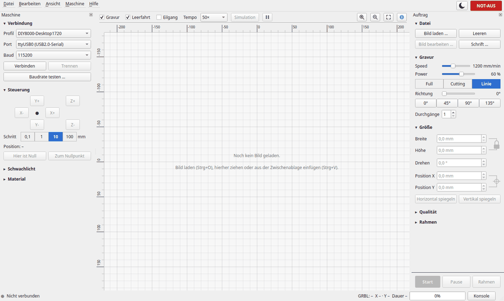

### Schritt 2: Mit dem Laser verbinden (oder dem Simulator)

Im Abschnitt **Verbindung** den **Port** wählen und auf **Verbinden** drücken. Hast du keinen Laser zur Hand, wähle **"Simulator (ohne Laser)"**. Damit lässt sich alles ausprobieren. Welche Baudrate dein Laser braucht und was bei Linux und Windows zu beachten ist, steht in Kapitel 4.

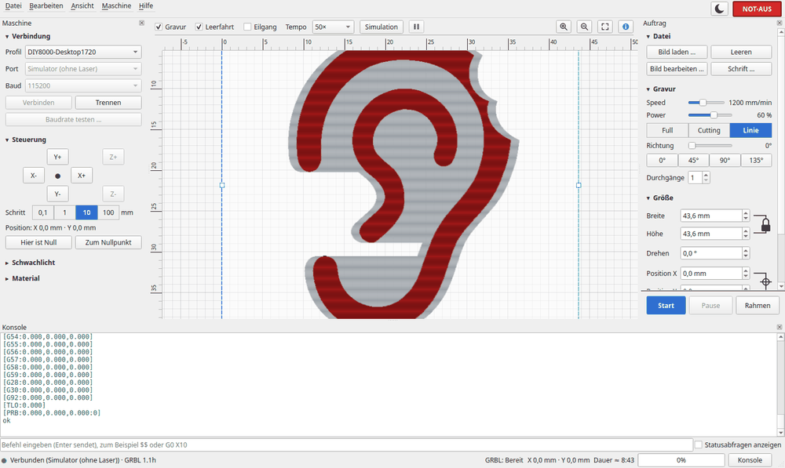

Nach dem Verbinden macht das Programm einen kurzen **Selbsttest** und liest die Firmware aus. Die Konsole unten zeigt, was dabei zwischen Programm und GRBL läuft.

### Schritt 3: Bild laden

**Datei → Bild laden …** (Strg+O), oder ein Bild auf die Arbeitsfläche ziehen. Es öffnet sich der Dialog **Bild bearbeiten**.

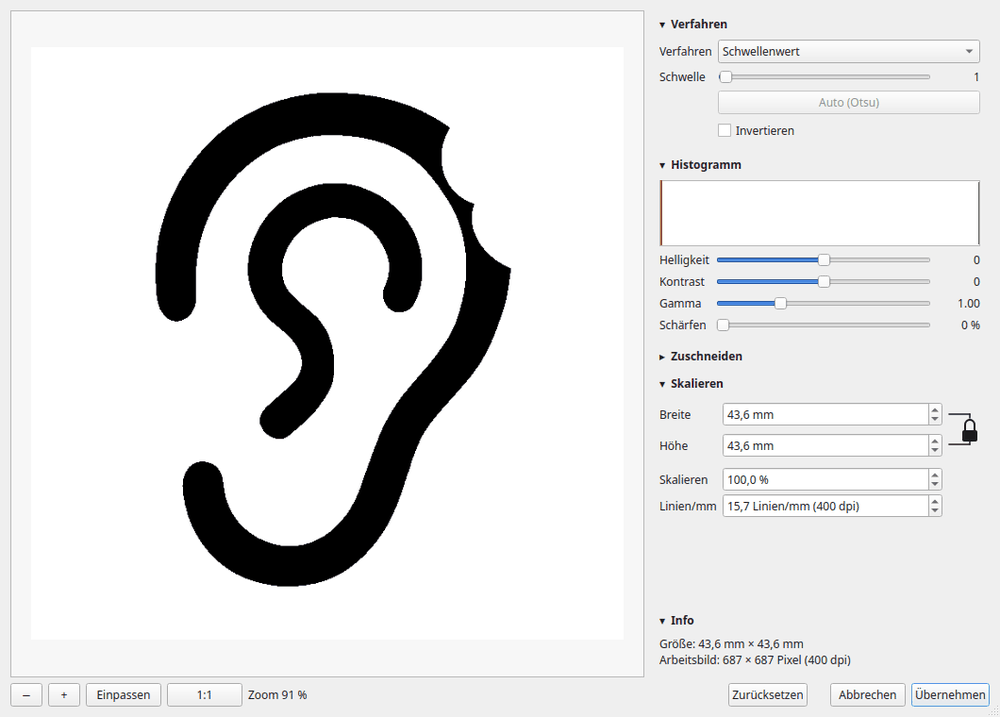

Für ein Logo mit klaren Flächen passt der **Schwellenwert**: Alles, was dunkler als die Schwelle ist, wird gebrannt. Der Knopf **Auto (Otsu)** schlägt einen guten Wert vor. Mit **Übernehmen** kommt das Bild auf die Arbeitsfläche.

### Schritt 4: Größe festlegen

Rechts im Abschnitt **Größe** stellst du **Breite** und **Höhe** in Millimetern ein. Das Schloss dahinter hält das Seitenverhältnis. Das Bild lässt sich auch mit der Maus verschieben und an den Ecken ziehen.

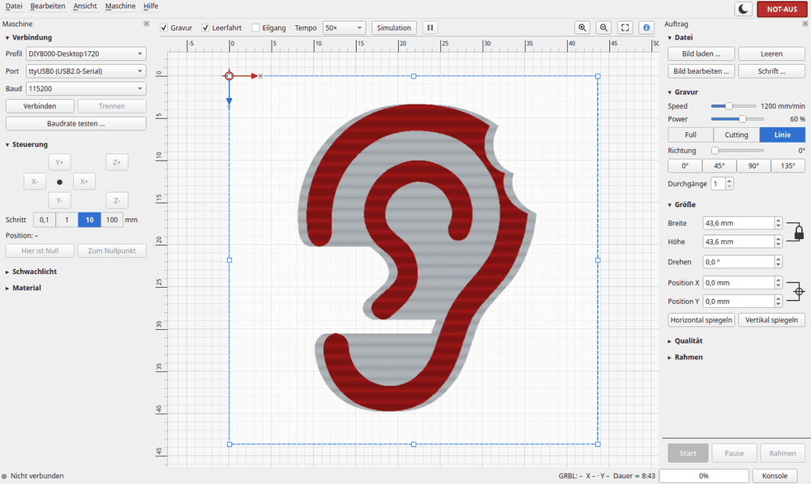

### Schritt 5: Gravurart und Werte

Im Abschnitt **Gravur** wählst du die Art (**Full**, **Cutting** oder **Linie**) und stellst **Speed** und **Power** ein. Für den Anfang gilt: lieber **zu wenig Leistung** als zu viel. Gute Werte findest du mit dem **Materialtest** (Kapitel 11), der eine Tabelle verschiedener Einstellungen brennt.

### Schritt 6: Nullpunkt setzen

Mit den **Jog**-Tasten im Abschnitt **Steuerung** den Kopf an die Stelle fahren, an der das Bild beginnen soll, und **"Hier ist Null"** drücken. Im Simulator ist das nicht nötig.

### Schritt 7: Rahmen abfahren

Der Knopf **Rahmen** (unten rechts) fährt die Umrandung des Bildes ab. So siehst du, ob das Bild aufs Material passt. Mit 0 % Leistung bleibt der Laser dabei aus.

### Schritt 8: Prüfen und Brennen

Mit **Simulation** (Leiste über der Arbeitsfläche) fährt das Programm den Auftrag am Bildschirm ab. Wenn alles stimmt: Schutzbrille auf, **Start**. Der gebrannte Teil färbt sich grün, unten läuft der Fortschritt mit der geschätzten Dauer.

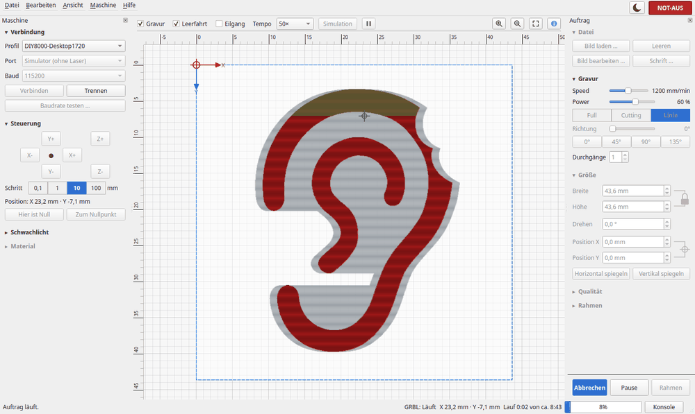

**Pause** hält an, **Abbrechen** beendet den Auftrag, und der rote **NOT-AUS** (Taste **Esc**) schaltet den Laser sofort aus. Während des Laufs kannst du **Speed** und **Power** mit den Reglern im Abschnitt Gravur ändern.

---

## 3. Die Oberfläche im Überblick


- **Menüleiste:** Datei, Bearbeiten, Ansicht, Maschine, Hilfe. Rechts oben: die Taste zum Umschalten zwischen **Hell und Dunkel** und der rote **NOT-AUS**.
- **Links** (Seitenleiste "Maschine"): **Verbindung**, **Steuerung**, **Schwachlicht**, **Material**.
- **Mitte:** die Arbeitsfläche mit Linealen und Raster. Darüber die **Vorschau-Leiste**.
- **Rechts** (Seitenleiste "Auftrag"): **Datei**, **Gravur**, **Größe**, **Qualität**, **Rahmen**. Darunter immer sichtbar: **Start**, **Pause** und **Rahmen**.
- **Unten:** die Statusleiste (Meldung, Zustand und Position von GRBL, Dauer, Fortschrittsbalken) und der Knopf **Konsole**.

Die Seitenleisten lassen sich über das Menü **Ansicht** ein- und ausblenden. Ihre Abschnitte klappen mit einem Klick auf die Überschrift auf und zu; das Programm merkt sich, welche offen sind.

### Das Menü im Überblick

| Menü | Einträge |
|---|---|
| **Datei** | Neu, Projekt öffnen / speichern / speichern unter, Zuletzt geöffnet, Bild laden, G-Code speichern, NC-Datei laden / schließen, Beenden |
| **Bearbeiten** | Rückgängig, Wiederholen, Bild bearbeiten, Schrift, Bild aus Zwischenablage einfügen, Einstellungen |
| **Ansicht** | Seitenleisten und Konsole ein-/ausblenden, Vorschau-Leiste, Raster anzeigen, Zoom, Bild einpassen |
| **Maschine** | Maschinenprofile, GRBL-Parameter, Firmware, Alarm aufheben, Materialtest, Kalibrierung, Protokoll |
| **Hilfe** | Handbuch, Über Laser-Dilettant, Über Qt |

### Tastenkürzel

| Taste | Wirkung |
|---|---|
| Strg+O | Bild laden |
| Strg+V | Bild aus der Zwischenablage einfügen |
| Strg+E | Bild bearbeiten |
| Strg+T | Text (Schrift) einfügen |
| Strg+N | Neu |
| Strg+Umschalt+O / Strg+S / Strg+Umschalt+S | Projekt öffnen / speichern / speichern unter |
| Strg+Umschalt+G | G-Code speichern |
| Strg+Z / Strg+Umschalt+Z | Rückgängig / Wiederholen |
| Strg++ / Strg+- / Strg+0 | Zoom größer / kleiner / Bild einpassen |
| Strg+, | Einstellungen |
| Esc | NOT-AUS |
| F1 | Handbuch öffnen; in einem Dialog das passende Kapitel |
| Pfeiltasten | Jog (nur, wenn kein Eingabefeld den Fokus hat) |
| Leertaste | Pause / Weiter (nur, wenn kein Eingabefeld den Fokus hat) |

### Die Vorschau-Leiste

Über der Arbeitsfläche steht eine Leiste mit:

- den Haken **Gravur**, **Leerfahrt** und **Eilgang**: sie schalten die Laserwege der Vorschau ein und aus (Gravur rot, Leerfahrt grau, Eilgang gelb);
- **Tempo** (1×, 10×, 50×, 200×, Maximal) für die **Simulation**, dazu der Knopf **Simulation** und ein Knopf zum Anhalten der Simulation;
- den Knöpfen für **Zoom** größer und kleiner und **Einpassen**.

Mehr dazu in Kapitel 9.

### Die Konsole

Mit dem Knopf **Konsole** (unten rechts) blendest du die Konsole ein. Sie zeigt alles, was zwischen Programm und GRBL läuft (gesendete und empfangene Zeilen). Im Eingabefeld darunter kannst du Befehle an GRBL schicken, zum Beispiel `$$` (alle Einstellungen) oder `G0 X10` (fahre zu X10), solange kein Auftrag läuft. Der Haken **"Statusabfragen anzeigen"** blendet die Statuszeilen ein, die GRBL mehrmals pro Sekunde schickt (sonst sind sie ausgeblendet).

---

## 4. Den Laser anschließen

### Voraussetzungen

- **Baudrate 115200.** Am DIY8000 getestet; andere Laser haben manchmal andere Werte. Der Knopf **"Baudrate testen …"** probiert gängige Werte durch, bis GRBL antwortet.
- **Linux:** Der Benutzer muss in der Gruppe `dialout` sein:
  ```bash
  sudo usermod -aG dialout $USER
  ```
  Danach abmelden und neu anmelden. Der Anschluss heißt meist `/dev/ttyUSB0`.
- **Windows:** Der USB-Chip (häufig CH340 oder CH341) braucht oft einen Treiber. Fehlt er, taucht kein Anschluss in der Liste auf.
- In GRBL muss der **Laser-Modus** an sein: `$32=1`. Ohne ihn schaltet GRBL den Laser nicht dynamisch.

### Verbinden

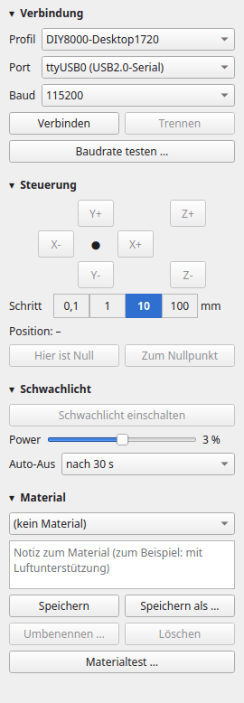

1. Im Abschnitt **Verbindung** das **Profil** (siehe Kapitel 5), den **Port** und die **Baudrate** wählen und **Verbinden** drücken. **Trennen** beendet die Verbindung.
2. Das Programm liest GRBL aus und macht einen **Selbsttest**: Es vergleicht `$30` (größter S-Wert) und den Laser-Modus mit dem Maschinenprofil. Weicht etwas ab, meldet es das und bietet an, das Profil anzupassen oder die GRBL-Parameter zu öffnen.
3. Bei jedem Verbinden schreibt das Programm Version, Einstellungen und Koordinaten von GRBL ins Systemprotokoll (Kapitel 14).

Mit **"Beim Start automatisch mit dem Laser verbinden"** (Einstellungen, Reiter Allgemein) verbindet das Programm beim Start mit dem zuletzt benutzten Port. Der **Simulator (ohne Laser)** wird nie automatisch verbunden.

### Der Nullpunkt

Dein Laser hat **keine Endschalter**. Er kennt seine Position nach dem Einschalten nicht. Du legst selbst fest, wo das Material beginnt:

1. Im Abschnitt **Steuerung** mit den **Jog**-Tasten den Kopf an die gewünschte Stelle fahren. Die Schrittweite (0,1 / 1 / 10 / 100 mm) wählst du neben dem Wort **Schritt**. **Z+** und **Z−** sind ausgegraut, wenn das Profil keine Z-Achse hat.
2. **"Hier ist Null"** drücken. Die aktuelle Position wird zum Nullpunkt (X0 Y0).
3. **"Zum Nullpunkt"** fährt später im Eilgang dorthin zurück, mit ausgeschaltetem Laser.

Unter den Jog-Tasten steht die aktuelle Position des Lasers (**Position: X … Y …**).

Der Nullpunkt wird mit `G10 L20 P1 X0 Y0` gesetzt. Verlass dich nicht darauf, dass er nach dem **Ausschalten des Lasers**, nach einem **Soft-Reset** oder nach einem **NOT-AUS** noch an derselben Stelle liegt: Ohne Endschalter kennt GRBL seine Position danach nicht sicher, besonders nach einem NOT-AUS mitten in einer Fahrt. **Setze den Nullpunkt nach dem Einschalten des Lasers neu.** Das Programm fragt deshalb nach einem Not-Aus oder Alarm vor dem nächsten Start: *"Ist der Nullpunkt noch richtig?"* Im Zweifel den Nullpunkt neu setzen.

### Jog

Die Jog-Tasten fahren den Kopf in einstellbaren Schritten. Mit gehaltener Taste fährt der Kopf Schritt für Schritt weiter, nach dem Loslassen höchstens noch einen Schritt. Die Schrittweiten stehen in den Einstellungen (Reiter Bedienung). Auf der Tastatur bewegen die Pfeiltasten den Kopf, wenn kein Eingabefeld den Fokus hat.

Manche GRBL-Varianten, darunter die des DIY8000 (meldet sich als "GRBL 1.1z"), nehmen den Jog-Befehl `$J=` mit `ok` an, **fahren aber nicht**. Darum fährt Laser-Dilettant standardmäßig mit normalen Fahrbefehlen. Wie du das umstellst, steht in Kapitel 5.

### Schwachlicht

Im Abschnitt **Schwachlicht** schaltest du mit **"Schwachlicht einschalten"** einen sehr schwachen Laserstrahl ein, mit dem du das Material anpeilen und fokussieren kannst.

- **Power:** die Leistung des Schwachlichts (Vorgabe 3 %). Sie ist nach oben begrenzt (Vorgabe 5 %, einstellbar unter Einstellungen → Laser).
- **Auto-Aus:** schaltet das Schwachlicht nach einer einstellbaren Zeit von selbst aus (Vorgabe 30 s). Sie startet bei jedem Jog neu.
- Mit `$32=1` schaltet GRBL den Laser nur während einer Fahrt ein. Das Schwachlicht fährt deshalb ständig ±0,1 mm hin und her. Dabei ist das Jog gesperrt. Beim Start eines Auftrags geht es automatisch aus.

---

## 5. Das Maschinenprofil

Menü **Maschine → Maschinenprofile …**. Das Profil beschreibt deinen Laser. Links steht die Liste der Profile mit **Neu**, **Kopieren**, **Umbenennen …** und **Löschen**. Das aktive Profil wählst du im Abschnitt Verbindung der linken Seitenleiste. Ein Profil "DIY8000-Desktop1720" wird beim ersten Start angelegt. Das letzte Profil lässt sich nicht löschen.

### Reiter Maschine

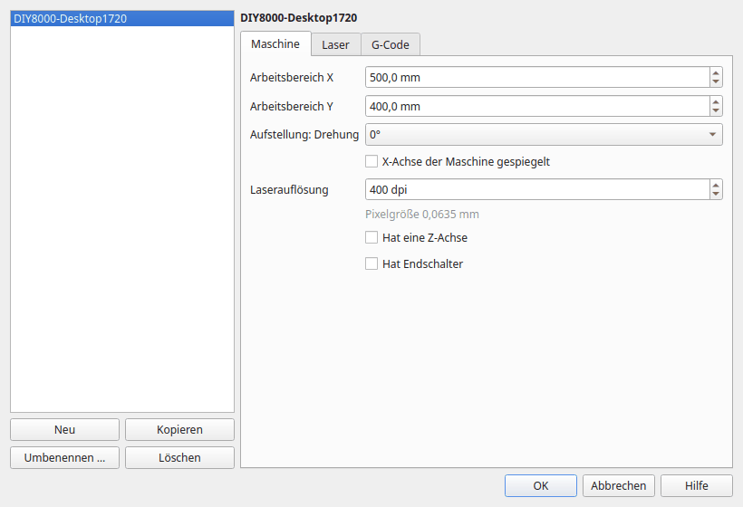

- **Arbeitsbereich X und Y:** der Verfahrweg der Achsen (Vorgabe X = 500 mm, Y = 400 mm). Ein Auftrag, der größer ist, wird abgewiesen. Ohne Endschalter prüft das das Programm selbst.
- **Aufstellung: Drehung** (0°, 90°, 180°, 270°) und **X-Achse der Maschine gespiegelt:** wie dein Laser relativ zu dir als Bediener steht. Das Programm rechnet erst beim Erzeugen des G-Codes um; `$3` in GRBL bleibt unberührt. Stimmt die Aufstellung nicht, brennt der Laser gedreht oder gespiegelt.
- **Laserauflösung** in dpi (Vorgabe 400). Daraus ergibt sich die Pixelgröße (400 dpi = 0,0635 mm).
- **Hat eine Z-Achse** und **Hat Endschalter:** beim DIY8000 beides nein.

### Reiter Laser

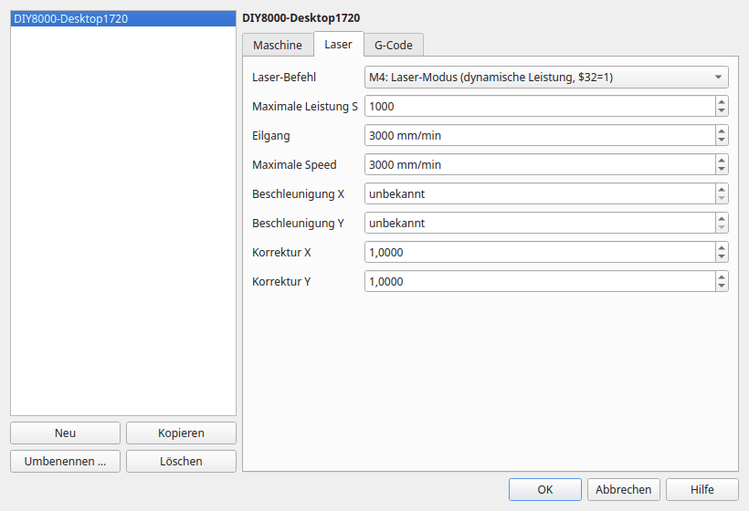

- **Laser-Befehl:** **M4** (Laser-Modus, dynamische Leistung, `$32=1`) oder **M3** (konstante Leistung). Mit `$32=0` in GRBL ist M3 nötig.
- **Maximale Leistung S:** der Wert von `$30` in GRBL für 100 % Leistung. Das Programm sendet nie einen größeren Wert.
- **Eilgang:** wie schnell der Laser ohne Brennen fährt (nur für die Zeitschätzung).
- **Maximale Speed:** höchste Geschwindigkeit beim Gravieren und Schneiden. Der Speed-Regler im Panel geht nicht darüber.
- **Beschleunigung X und Y** (nur für die Zeitschätzung; "unbekannt" heißt: das Programm nimmt einen Standardwert).
- **Korrektur X und Y:** die Faktoren aus der Kalibrierung (Kapitel 11), Vorgabe 1,0000.

### Reiter G-Code

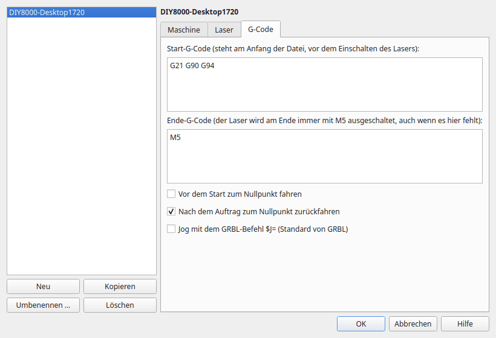

- **Start-G-Code:** steht am Anfang der Datei, vor dem Einschalten des Lasers.
- **Jog mit dem GRBL-Befehl `$J=`** (Standard von GRBL): Vorgabe **aus**. Wenn das Jog bei deinem Laser nicht fährt, obwohl die Konsole `ok` zeigt, probiere den Haken umzustellen. Mit `$J=` hält der Kopf beim Loslassen sofort an.
- **Vor dem Start zum Nullpunkt fahren** (Vorgabe aus): Nicht angehakt geht der Auftrag davon aus, dass der Laser schon auf dem Nullpunkt steht.
- **Nach dem Auftrag zum Nullpunkt zurückfahren** (Vorgabe an): Nicht angehakt bleibt der Laser dort stehen, wo der Auftrag endet.

### GRBL-Parameter

Menü **Maschine → GRBL-Parameter …** liest und schreibt die Einstellungen `$0` bis `$132` des Lasers. Änderungen wirken sofort und bleiben nach dem Ausschalten erhalten. Bitte nur ändern, was du verstehst: Falsche Werte können den Laser falsch fahren lassen.

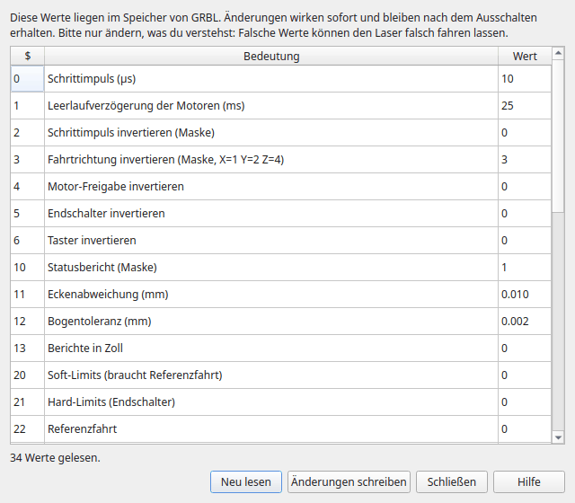

Die wichtigsten Werte für diesen Zweck: `$30` (größter S-Wert), `$32` (Laser-Modus, muss 1 sein), `$100` und `$101` (Schritte pro Millimeter, bestimmen den Maßstab), `$110` und `$111` (höchste Geschwindigkeit), `$120` und `$121` (Beschleunigung) und `$130` und `$131` (Verfahrweg). Der Knopf **Neu lesen** holt die Werte noch einmal, **Änderungen schreiben** sendet die geänderten Zeilen.

---

## 6. Ein Bild laden und bearbeiten

**Laden:** Datei → Bild laden (Strg+O), das Bild auf die Arbeitsfläche ziehen oder aus der Zwischenablage einfügen (Strg+V). Unterstützt sind gängige Rasterformate (JPG, PNG, BMP und weitere) sowie **SVG** als Vektorgrafik. Dazu gibt es Text (Strg+T), siehe Kapitel 12.

Beim Laden wird das Bild in seiner Größe aus **Bildpixel × Pixelgröße** angelegt (bei 400 dpi etwa 0,0635 mm je Pixel). Das Original bleibt unverändert; deine Einstellungen werden im Projekt gespeichert.

Rechts im Abschnitt **Datei** gibt es dazu die Knöpfe **Bild laden …**, **Leeren** (die Arbeitsfläche leeren), **Bild bearbeiten …** und **Schrift …**.

### Bild bearbeiten (Strg+E)

Links die Vorschau, rechts die Regler. Alles wirkt sofort. Unter der Vorschau stehen **Zoom** (−, +, Einpassen, 1:1) und die Knöpfe **Zurücksetzen**, **Abbrechen** und **Übernehmen**.


**Verfahren:** Wie aus dem Bild Schwarz und Weiß wird.

- **Schwellenwert:** Alles, was dunkler ist als die Schwelle, wird gebrannt. Der Regler **Schwelle** stellt sie ein; **Auto (Otsu)** schlägt einen guten Wert vor (er ist danach von Hand verstellbar). Das **Histogramm** zeigt, wie viele Pixel welche Helligkeit haben. Gut für Logos, Schrift und Strichzeichnungen.
- **Floyd-Steinberg, Atkinson, Bayer (Dithering):** Grautöne werden als Punktmuster nachgebildet. **Feinheit** stellt die Punktgröße ein (links fein, rechts grob; Punktgröße in Millimetern darunter). Gut für Fotos. Zum Beurteilen die Vorschau auf **1:1** stellen.
- **Graustufen-Leistung:** Der Laser brennt die Grautöne mit unterschiedlicher Leistung statt mit Punkten.

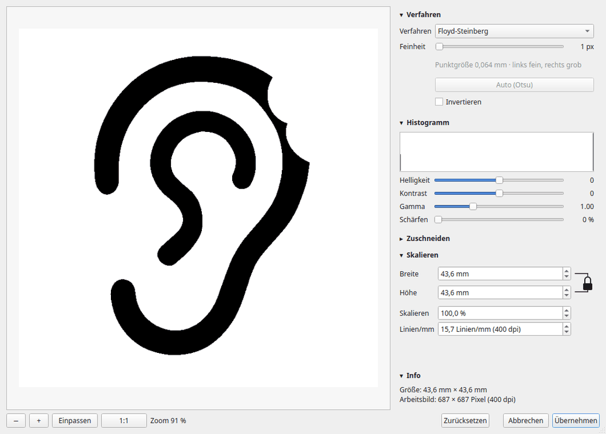

**Graustufen-Leistung** hat drei zusätzliche Regler: **Mindestleistung** (Vorgabe 10 %, für fast weiße Punkte), **Höchstleistung** (Vorgabe 100 % der Gravur-Leistung) und **Stufen** (Vorgabe 32; weniger Stufen ergeben weniger G-Code). Reines Weiß bleibt aus, dazwischen steigt die Leistung gleichmäßig; **Gamma** wirkt als Kurve dazu.

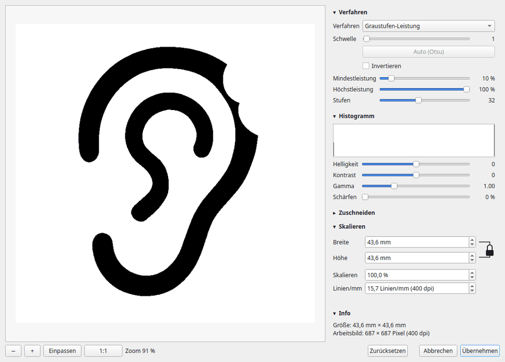

**Invertieren** tauscht hell und dunkel. Transparente Stellen zählen als weiß.

**Vorbereitung** (darunter): **Helligkeit**, **Kontrast**, **Gamma** und **Schärfen**.

**Zuschneiden:** **Ganzes Bild**, **"Bereich wählen …"** (mit der Maus einen Ausschnitt aufziehen und **"Bereich übernehmen"**) oder **"Auf Inhalt zuschneiden"** (schneidet das leere Weiß am Rand ab).

**Skalieren:** **Breite** und **Höhe** in Millimetern (mit Schloss), **Skalieren** in Prozent und die Auflösung (**Linien/mm**, mit dpi). Das Arbeitsbild hat die Pixelgröße des Lasers. Das Programm warnt, wenn das Bild weniger Pixel hat (wird hochgerechnet), viel feiner als der Laser ist (wird verkleinert) oder größer als der Arbeitsbereich.

**Info** zeigt Größe und Arbeitsbild in Pixeln und dpi.

**Für Cutting** (Umrisse): zusätzliche Regler vereinfachen die Kurven (**Kurven vereinfachen**, **Flecken ignorieren**, **Eckenschärfe**), damit aus dem Bild saubere Umrisse werden.

**SVG-Dateien:** Größe aus den SVG-Angaben. Bei Full und Cutting gilt nur Schwarz/Weiß. Striche lassen sich als Mittellinie oder zusätzlich als Fläche ausgeben, Füllungen als Umriss. Text in der SVG-Datei wird nicht umgewandelt; bitte vorher in Pfade umwandeln.

Mit **Übernehmen** erscheint das Ergebnis auf der Arbeitsfläche. Später lässt es sich über **Bearbeiten → Bild bearbeiten** wieder ändern.

---

## 7. Platzieren, Nullpunkt und Rahmen

### Größe und Lage (rechts, Abschnitt Größe)

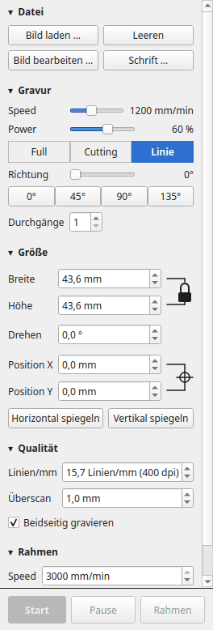

- **Breite und Höhe** in Millimetern, mit dem **Schloss** dahinter: geschlossen bleibt das Seitenverhältnis erhalten.
- **Drehen** in Grad, **Horizontal spiegeln** und **Vertikal spiegeln**.
- **Position X und Y:** wo die Grafik zum Nullpunkt liegt. Das Symbol dahinter zeigt, an welchem Punkt der Grafik sie angesetzt wird (siehe Job-Ursprung).
- Du kannst die Grafik auch mit der Maus auf der Arbeitsfläche **verschieben** und an den Ecken **ziehen**.
- **Zoom** mit dem Mausrad, Verschieben der Ansicht mit gedrückter mittlerer Maustaste; Strg+0 passt das Bild ein.

### Job-Ursprung

Der **Job-Ursprung** legt fest, welcher Punkt des Auftrags auf den Nullpunkt kommt: eine der vier Ecken oder die Mitte (Standard: obere linke Ecke). Du stellst ihn in den **Einstellungen, Reiter Laser** ein. Er gilt für das aktuelle Bild und als Standard für neue Bilder. Lineale und Maße zählen von diesem Punkt aus.

### Rahmen

Der **Rahmen** fährt die Umrandung des Auftrags ab, damit du siehst, wo er landet. Er folgt der gedrehten Grafik und beginnt an der Ecke beim Ursprung. Im Abschnitt **Rahmen** (rechts) stellst du **Speed** und **Power** ein. Mit **0 % Leistung** bleibt der Laser dabei aus. Mit etwas Leistung zeichnet er die Linie sichtbar auf das Material. Gestartet wird mit dem Knopf **Rahmen** unten rechts.

Es kommt **keine Warnung** vor dem Rahmen. Mit Leistung über 0 % brennt er, also Schutzbrille aufsetzen. Fragen stellt das Programm nur, wenn GRBL nicht bereit ist oder die Position nach einem Not-Aus unsicher ist.

---

## 8. Gravurarten und Einstellungen

Im Abschnitt **Gravur** wählst du die Art:

| Art | Was der Laser tut | Wofür |
|---|---|---|
| **Full** | Füllt zusammenhängende Flächen im Zickzack, ohne abzusetzen. Eine dünne Linie wird zu einer schmalen Fläche. | gefüllte Motive, Logos |
| **Cutting** | Fährt die Umrisse der schwarzen Flächen nach. Eine dünne Linie ergibt eine schmale Doppelkontur. | Schneiden, Umranden |
| **Linie** | Rasterzeilen über das ganze Bild (auch über leere Stellen, dort mit Leistung 0). | Fotos, Dithering |

Dazu stellst du ein:

- **Speed** (mm/min oder mm/s, je nach Einstellung) und **Power** (Prozent der Maschine).
- **Richtung:** der Winkel der Zeilen (0°, 45°, 90°, 135° oder frei mit dem Regler). Bei Holz verläuft die Gravur oft besser quer zur Maserung.
- **Durchgänge:** wie oft der Auftrag wiederholt wird.
- **Überscan** (Abschnitt Qualität): Anlauf und Auslauf ohne Leistung an beiden Zeilenenden, damit die Ränder sauber werden. Der Wert kommt aus dem Maschinenprofil und lässt sich pro Auftrag ändern.
- **Beidseitig gravieren** (Qualität): Hin- und Rückfahrt brennen. Das spart Zeit, kann aber bei lockerem Spiel in der Mechanik leichte Doppelkonturen ergeben.
- **Linien/mm** (Qualität): die Auflösung. Im Cutting ausgegraut, weil dort Konturen zählen. Dort steht stattdessen die **Kurvengenauigkeit**.

**Auflösung:** Die Einheit der Auflösung wählst du in den Einstellungen: Linien/mm (mit dpi), dpi oder Pixelgröße in Millimetern.

---

## 9. Prüfen: Vorschau, Simulation, G-Code

- **Vorschau:** Mit den Haken der Vorschau-Leiste zeigst du die **Laserwege**: **Gravur** (rot), **Leerfahrt** (grau) und auf Wunsch den **Eilgang** (gelb). Sie rechnet im Hintergrund und braucht bei großen Bildern einen Moment.
- **Simulation:** Fährt den Auftrag am Bildschirm ab und färbt den schon gebrannten Teil grün. Das **Tempo** (1× bis Maximal) stellst du in der Leiste ein. Sie läuft auch ohne verbundenen Laser.
- **Zeitschätzung:** Die Dauer steht in der Statusleiste (zum Beispiel **Dauer ≈ 8:43**). Sie rechnet mit Eilgang und Beschleunigung aus dem Profil.
- **Arbeitsbereich-Prüfung:** Ist der Auftrag größer als der Arbeitsbereich, sperrt das Programm den Start.
- **G-Code speichern** (Strg+Umschalt+G): schreibt den G-Code als Datei, zum Beispiel für ein anderes Programm. Der G-Code enthält immer Millimeter und mm/min, egal was du anzeigst.

Große Rasterbilder erzeugen sehr viel G-Code. Das Programm schreibt ihn in eine temporäre Datei und sendet ihn von dort; gleiche Fahrstücke werden zusammengefasst.

---

## 10. Brennen

### Vor dem Start

1. Laser verbunden, Selbsttest in Ordnung, Nullpunkt gesetzt.
2. Material fixiert, Schutzbrille auf, nichts Brennbares im Arbeitsbereich.
3. **Rahmen** abfahren und prüfen, dass der Auftrag aufs Material passt.
4. Der **Warnhinweis vor dem Start** erinnert an diese Punkte. Du kannst ihn in den Einstellungen (Reiter Allgemein) abschalten.

### Start, Pause, Abbrechen

- **Start** schaltet das Schwachlicht aus und sendet den Auftrag. Der Fortschritt läuft in der Statusleiste (Lauf-Zeit und geschätzte Dauer), und auf der Arbeitsfläche wird der gebrannte Teil grün.
- **Pause** hält den Kopf an (Feed Hold). GRBL schaltet den Laser dabei aus. **Weiter** (derselbe Knopf) setzt an derselben Stelle fort.
- **Abbrechen** (derselbe Knopf wie Start, solange ein Auftrag läuft) fragt nach und bricht ab: Reset und `M5`. Die Position kann danach ungenau sein.
- Der **Rahmen** und der **Materialtest** laufen auf demselben Weg.


### NOT-AUS

Der rote **NOT-AUS** (oder **Esc**) sendet einen Soft-Reset und danach `M5`, verwirft die Warteschlange und beendet den Auftrag. Er ist **kein Hardware-Not-Aus**. Nach einem NOT-AUS fragt das Programm vor dem nächsten Start nach der Position.

### Live-Regler

Während eines Auftrags wirken die Regler **Speed** und **Power** im rechten Abschnitt Gravur direkt auf den laufenden Auftrag. Beim Start gelten ihre Werte als 100 %. Du kannst Speed und Leistung auf 10 bis 200 % des Startwerts stellen. Die Leistung geht aber höchstens bis 100 % der Maschine, und GRBL kappt `S` selbst bei `$30`. Bei einer NC-Datei zeigen die Regler Prozent (100 % = wie in der Datei).

### Alarme und Fehler

- **Alarm:** Bei einem Alarm von GRBL schaltet das Programm den Laser aus und zeigt einen Dialog mit dem Grund. Mit **Maschine → Alarm aufheben ($X)** hebst du ihn nach einer Rückfrage auf. Danach den Nullpunkt prüfen.
- **Fehler im Auftrag:** GRBL meldet manchmal eine Zeile als fehlerhaft. Der Auftrag hält an und zeigt einen Dialog mit der Zeile. Du kannst abbrechen, die Zeile überspringen und fortsetzen (das Ergebnis kann sich dann verschieben) oder den NOT-AUS drücken.
- **Verbindung verloren:** siehe Kapitel 1.
- **Das Programm beenden** während eines Auftrags fragt nach; bei "Ja" gehen Reset und `M5` an den Laser, dann wird getrennt.

---

## 11. Material, Materialtest und Kalibrierung

### Materialien

Im linken Abschnitt **Material** speicherst du Gravur- und Schnittwerte (Speed und Power) für ein Material. Das Feld **Notiz** nimmt Hinweise auf (zum Beispiel "mit Luftunterstützung").

- **Speichern** überschreibt das gewählte Material mit den aktuellen Werten, **Speichern als …** legt ein neues an, dazu **Umbenennen …** und **Löschen**.
- **Materialtest …** öffnet den Materialtest (siehe unten).

Die Materialien liegen als JSON-Dateien in `~/.config/Laser-Dilettant/materials/`.

### Materialtest (Maschine → Materialtest …)

Der Test brennt eine Tabelle kleiner Felder mit verschiedenen Werten, damit du siehst, welche Einstellung das beste Ergebnis gibt. Er läuft wie ein eigener Auftrag, dein Bild bleibt unberührt.

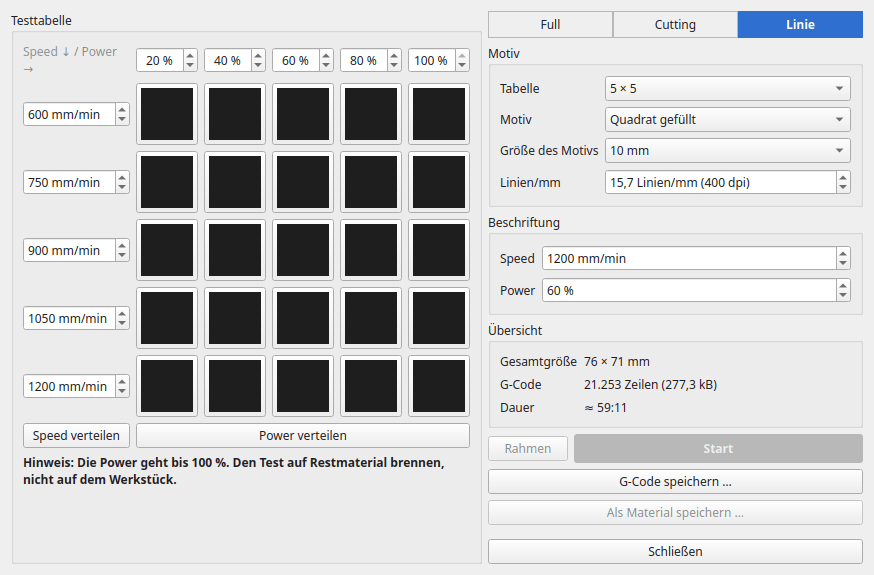

1. **Tabelle** 3×3, 4×4 oder 5×5, **Motiv** (Kreis oder Quadrat, gefüllt oder Umriss, Quadrat mit Verlauf), **Größe des Motivs** (5 bis 20 mm) und **Modus** (Full, Cutting, Linie).
2. Oben stehen die **Power**-Werte je Spalte (Vorgabe 20 bis 100 %), links die **Speed**-Werte je Zeile (Vorgabe 50 bis 100 % deiner aktuellen Speed). Beide lassen sich einzeln ändern; **"Speed verteilen"** und **"Power verteilen"** füllen sie gleichmäßig.
3. Die Werte werden **mitgraviert** (nur Zahlen, ohne Einheit), damit du später weißt, welches Feld welche Einstellung war. Das Feld **Beschriftung** legt fest, welche Werte als Überschrift stehen.
4. Die **Übersicht** zeigt Gesamtgröße, Anzahl der G-Code-Zeilen und die Dauer. **Rahmen**, **Start** und **G-Code speichern …** wie bei einem Bild. Ist die Tabelle größer als der Arbeitsbereich, ist der Start gesperrt.
5. Der Test gehört auf **Restmaterial**; bei Power über 50 % warnt das Programm.
6. Danach das beste Feld in der Vorschau anklicken und **"Als Material speichern …"**: Speed und Power gehen ins Material.

### Kalibrierung (Maschine → Kalibrierung …)

Die Kalibrierung gleicht kleine Maßfehler der Achsen aus (der Laser brennt zum Beispiel 100 mm lang, misst aber 99,2 mm).

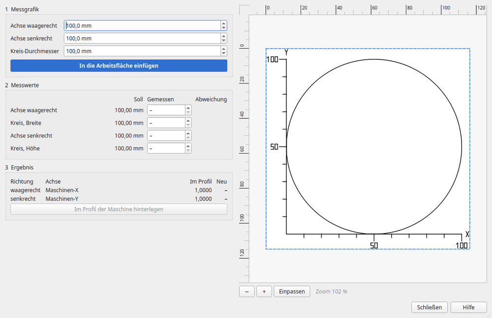

1. **Messgrafik:** ein Winkel (waagerechte und senkrechte Achse, Vorgabe je 100 mm, Teilstriche alle 10 mm) und ein Kreis (Durchmesser 100 mm). **"In die Arbeitsfläche einfügen"** ersetzt dein Bild durch die Grafik (mit Rückfrage), schaltet auf Cutting und setzt sie auf den Nullpunkt.
2. Mit dem normalen **Start** brennen, auf geeignetem Material.
3. **Messwerte:** die gebrannte **Achsenlänge** und die **Breite und Höhe des Kreises** je Richtung nachmessen und eintragen. Leere Felder zählen als nicht gemessen.
4. **Ergebnis:** Der Dialog zeigt Abweichung und den **neuen Faktor** (Soll durch gemessen) je Richtung. Mit **"Im Profil der Maschine hinterlegen"** schreibst du ihn nach Rückfrage ins aktive Maschinenprofil.

Die Faktoren gelten für Bilder, Rahmen und Materialtest. Fremde NC-Dateien und der Jog werden nicht korrigiert. Die Messgrafik selbst wird immer **ohne** die im Profil hinterlegten Faktoren erzeugt, sonst würde die Messung verfälscht.

---

## 12. Text, NC-Dateien und Projekte

### Text (Strg+T)

Der Dialog **Text** setzt einen Text als **Vektorpfade** (Linien und Konturen) in die Arbeitsfläche. Er lässt sich wie ein Bild schneiden (Cutting) oder füllen (Full).

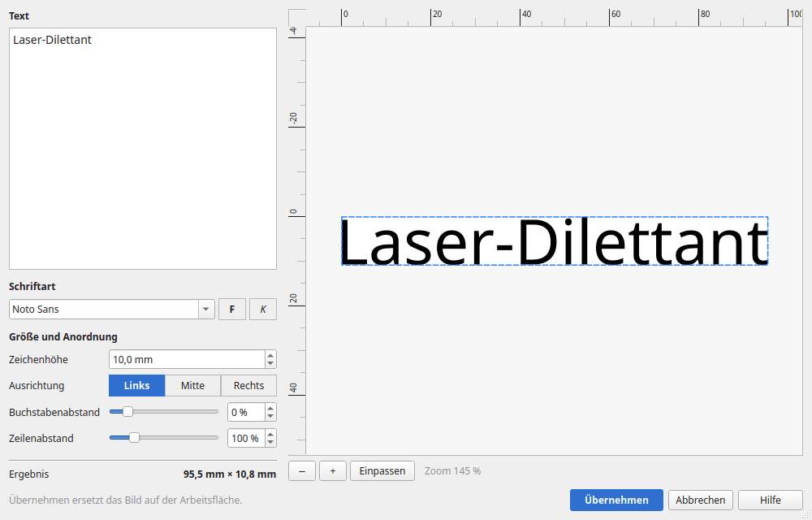

- **Text:** das große Feld links oben.
- **Schriftart** (mit **F** für Fett und **K** für Kursiv).
- **Größe und Anordnung:** **Zeichenhöhe** in Millimetern, **Ausrichtung** (Links, Mitte, Rechts), **Buchstabenabstand** und **Zeilenabstand**.
- **Ergebnis** zeigt die Größe des Textes in Millimetern. Rechts sitzt die Vorschau mit Linealen.
- **Übernehmen** ersetzt das Bild auf der Arbeitsfläche durch den Text.

### NC-Dateien

**Datei → NC-Datei laden …** lädt fertigen G-Code, zum Beispiel aus LaserGRBL, einem Inkscape-Plugin oder von Engraver Master. Das Programm zeigt die Wege, simuliert sie und brennt sie am Laser. Ändern oder wiederholen lässt sich so eine Datei noch nicht.

- Der Nullpunkt der Datei liegt am Nullpunkt der Anzeige. Der Job-Ursprung gilt hier nicht; der **Rahmen** fährt das umschließende Rechteck aller Wege ab.
- Beim Laden prüft das Programm die Datei. Zeilen mit Einstellungsbefehlen (`$…`), Befehle für Koordinatensysteme (`G10`, `G92`, `G53`, `G55` bis `G59`) und unbekannte Befehle werden **nicht gesendet**, und ein Hinweis zeigt die Zeilen. Ein `S` über dem Maximum der Maschine wird auf das Maximum begrenzt. Die Originaldatei bleibt unverändert; gesendet wird eine bereinigte Kopie.
- Das Bild und seine Einstellungen sind in dieser Zeit ausgegraut. Zurück geht es mit **Datei → NC-Datei schließen** oder dem Knopf **Leeren** im rechten Panel.

### Projekte (`.ldproj`)

Ein Projekt speichert dein Bild (mit relativem Pfad, falls möglich), alle Bild- und Gravureinstellungen, Größe und Lage. Datei → **Projekt speichern / öffnen**, dazu eine Liste der zuletzt geöffneten. Das Programm sichert in einstellbaren Abständen automatisch (Vorgabe: alle 2 Minuten) und bietet nach einem Absturz die Wiederherstellung an.

---

## 13. Einstellungen

Menü Bearbeiten → **Einstellungen …** (Strg+,). Änderungen am Design, an den Einheiten und an der Anzeige wirken sofort. **Abbrechen** nimmt sie zurück. Jeder Reiter hat **"Standard wiederherstellen"**.

### Allgemein

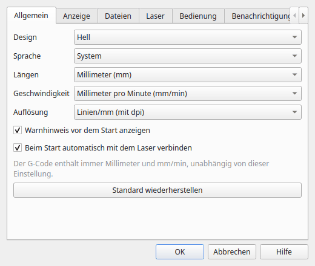

- **Design:** System, Hell oder Dunkel.
- **Sprache:** bisher nur Deutsch. Eine Änderung wirkt nach einem Neustart.
- **Längen:** Millimeter oder Zoll. **Geschwindigkeit:** mm/min oder mm/s. **Auflösung:** Linien/mm (mit dpi), dpi oder Pixelgröße (mm). Der G-Code enthält immer Millimeter und mm/min.
- **Warnhinweis vor dem Start anzeigen** und **Beim Start automatisch mit dem Laser verbinden**.

### Anzeige

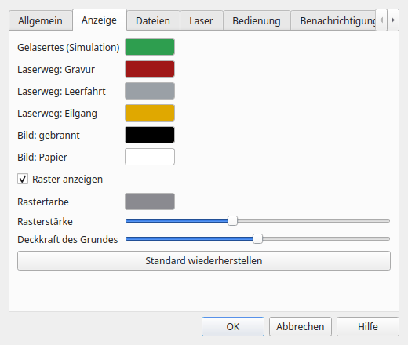

Farben für den gebrannten Teil der Simulation, die Laserwege (Gravur, Leerfahrt, Eilgang) und die Bildanzeige (**"gebrannt"** und **"Papier"**). Dazu das **Raster** (ein/aus, Farbe, Stärke) und die **Deckkraft des Grundes** der Arbeitsfläche.

### Dateien

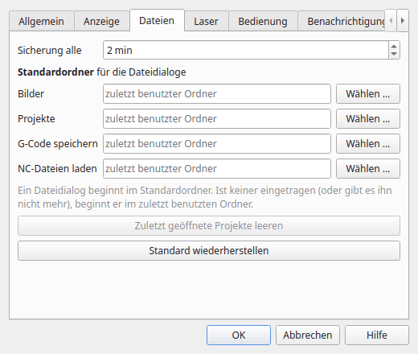

**Sicherung alle** (Abstand der automatischen Sicherung, 0 = aus), **Standardordner** für Bilder, Projekte, G-Code und NC-Dateien (leer = der zuletzt benutzte Ordner) und **"Zuletzt geöffnete Projekte leeren"**.

### Laser

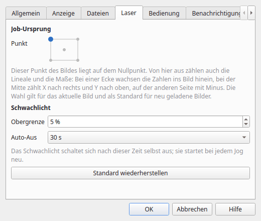

Der **Job-Ursprung** (fünf Punkte: vier Ecken und die Mitte) und das **Schwachlicht** (**Obergrenze** der Leistung und **Auto-Aus**).

### Bedienung

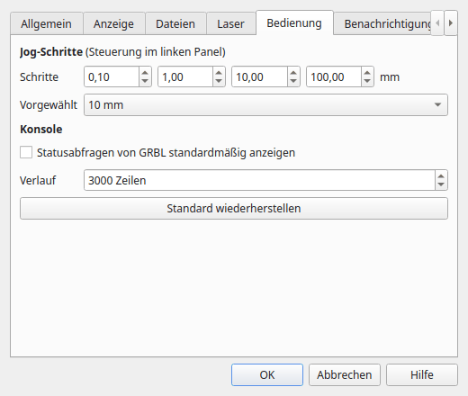

Die vier **Jog-Schritte** (aufsteigend, in Millimetern), welcher davon **vorgewählt** ist, und die **Konsole**: ob Statusabfragen standardmäßig angezeigt werden und wie lang der Verlauf ist.

### Benachrichtigung und Webzugriff

Die Reiter **Benachrichtigung** (ntfy) und **Webzugriff** (Fernansicht) sind in den Kapiteln 15 und 16 beschrieben.

---

## 14. Protokolle

Menü Maschine → **Protokoll …** öffnet das Protokollfenster mit drei Reitern: **Aufträge**, **System** (mit Filter nach Stufe und Suchtext) und **Statistik**.

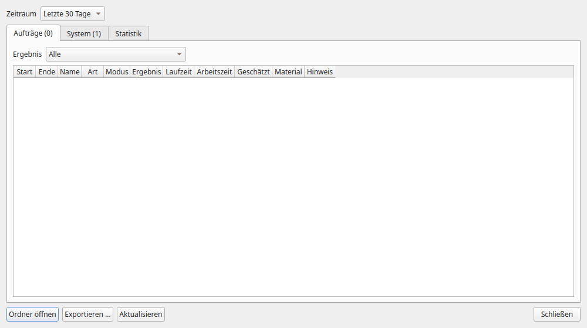

- **Auftragsprotokoll:** eine Zeile je Auftrag (Start, Ende, Name, Art, Modus, Speed, Leistung, Größe, Material, Profil, Ergebnis, Laufzeit, Arbeitszeit und mehr). Ergebnis ist zum Beispiel Fertig, Abgebrochen, NOT-AUS, Alarm oder Verbindung verloren.
- **Systemprotokoll:** Programmstart und -ende, Verbinden und Trennen, Alarme, Fehler, die Firmware von GRBL bei jedem Verbinden, Meldungen an ntfy und alle Zugriffe der Fernansicht.
- **Statistik:** Anzahl und Dauer der Aufträge, nach Zeitraum gefiltert.
- **Exportieren** schreibt die gerade gezeigten Zeilen als CSV (für Tabellenprogramme), **Ordner öffnen** zeigt die Dateien.

Die Dateien liegen als CSV je Monat in `~/.local/share/Laser-Dilettant/logs/` (`jobs-JJJJ-MM.csv` und `system-JJJJ-MM.csv`). Es wird nichts automatisch gelöscht.

---

## 15. Meldungen aufs Handy (ntfy)

Mit **ntfy** schickt das Programm eine Nachricht aufs Handy, wenn etwas schiefgeht oder der Auftrag fertig ist. Das ist die verlässlichste Art, nebenbei Bescheid zu bekommen, weil es auch bei gesperrtem Handy funktioniert.

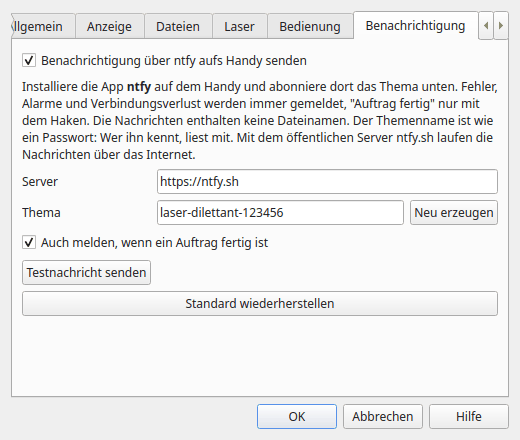

**Einrichten**

1. Auf dem Handy die App **ntfy** installieren.
2. Im Programm: Einstellungen → Reiter **Benachrichtigung**, Haken **"Benachrichtigung über ntfy aufs Handy senden"**. Das Programm erzeugt ein Thema der Form `laser-dilettant-123456`.
3. In der ntfy-App dasselbe Thema abonnieren (Server `ntfy.sh`).
4. **"Testnachricht senden"** drücken. Sie sollte sofort auf dem Handy erscheinen.

**Was gemeldet wird**

- **Immer** (bei eingeschaltetem ntfy): Alarm, Fehler im Auftrag, Verbindung verloren, GRBL wurde zurückgesetzt, "GRBL antwortet nicht" und sonstiger Abbruch.
- **Mit Haken** "Auch melden, wenn ein Auftrag fertig ist": das Ende des Auftrags mit der Laufzeit. Der Rahmen meldet nie "fertig".
- **Nie:** Abbruch und NOT-AUS durch dich selbst.

Die Nachrichten enthalten keine Dateinamen oder Pfade. Gleiche Störungen innerhalb von 5 Sekunden kommen nur einmal.

**Sicherheit des Themas:** Das Thema ist wie ein Passwort: Wer den Namen kennt, kann mitlesen und selbst Nachrichten senden. Eine Zahl mit sechs Stellen ist **erratbar**, weil der Anfang `laser-dilettant-` bekannt ist. Mit **"Neu erzeugen"** bekommst du ein neues Thema, das du dann am Handy neu abonnieren musst. Wer mehr Schutz will, trägt einen eigenen, langen Namen ein (Buchstaben, Ziffern, `-` und `_`, höchstens 64 Zeichen) oder nutzt einen eigenen ntfy-Server.

---

## 16. Die Fernansicht im Heimnetz

Die Fernansicht ist eine Webseite, die das Programm anbietet. Auf dem Handy oder Tablet im selben WLAN siehst du Fortschritt, Zeiten und das Bild des schon Gebrannten und kannst auf Wunsch pausieren, abbrechen und Speed und Leistung verstellen. **Sie ersetzt nicht die Aufsicht.**

### Einschalten

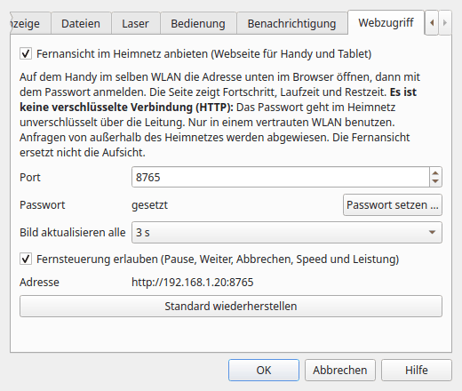

Einstellungen → Reiter **Webzugriff**:

1. **Passwort setzen …** (zweimal eingeben; es gibt keine Mindestlänge, ein leeres Passwort geht nicht). Das Passwort wird nur als Hash gespeichert.
2. Haken **"Fernansicht im Heimnetz anbieten"**. Der **Port** ist 8765 (änderbar).
3. Optional: **"Fernsteuerung erlauben"**. Ohne diesen Haken kann das Handy **nur zusehen**. Die Vorgabe ist aus.
4. **Bild aktualisieren alle** stellt ein, wie oft die Seite das Bild des Gebrannten abholt (1 bis 60 Sekunden, Vorgabe 3).
5. Unter **Adresse** steht, wie du das Programm im Heimnetz erreichst, zum Beispiel `http://192.168.1.20:8765`. Diese Adresse im Browser des Handys öffnen und mit dem Passwort anmelden.

Das Programm muss laufen, und der Rechner muss im Heimnetz erreichbar sein (Firewall: der Port muss frei sein).

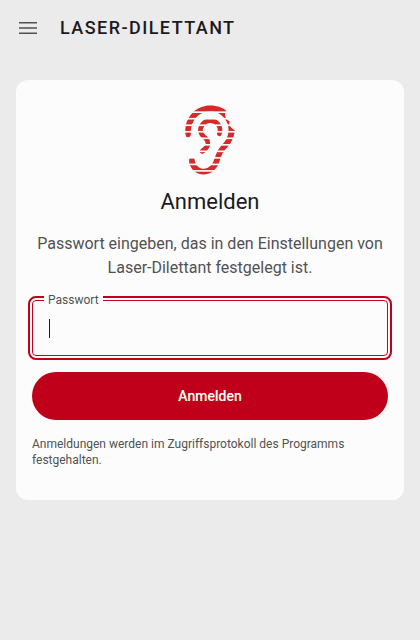

### Was die Seite zeigt

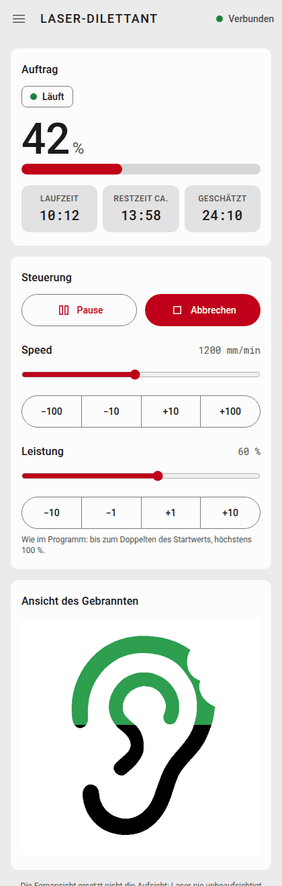

- **Auftrag:** Zustand (Läuft, Pause, Alarm, Fertig, Keine Verbindung zum Laser, Kein Auftrag), Fortschritt in Prozent, **Laufzeit**, **geschätzte Dauer** und **Restzeit**. Im Alarm- oder Fehlerfall steht der Text dabei.
- **Ansicht des Gebrannten:** Das Bild mit dem schon gebrannten Teil in der Fortschrittsfarbe. Es wird im eingestellten Takt aufgefrischt, nur solange die Seite sichtbar ist.
- **Ton bei Fertig:** Wechselt der Auftrag auf "fertig", spielt die Seite drei Töne und setzt ein Häkchen in den Titel des Tabs. Im Menü der Seite lässt sich der Ton ein- und ausschalten. Browser erlauben Ton erst, nachdem du die Seite einmal berührt hast. Handys halten Seiten im Hintergrund oft an; dort kommt der Ton nicht. Verlässlich ist dann nur ntfy.

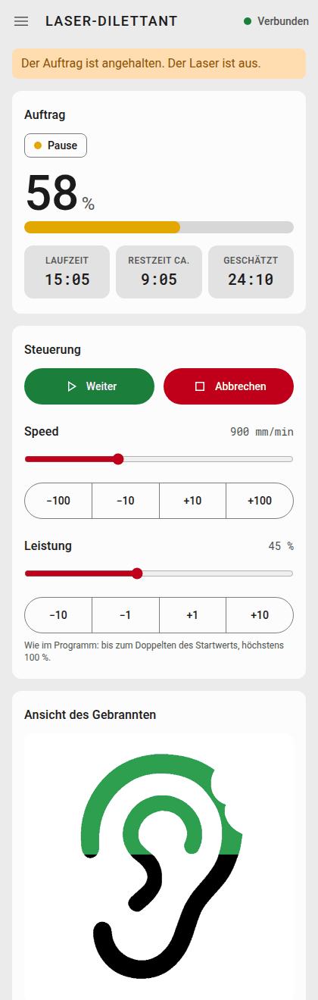

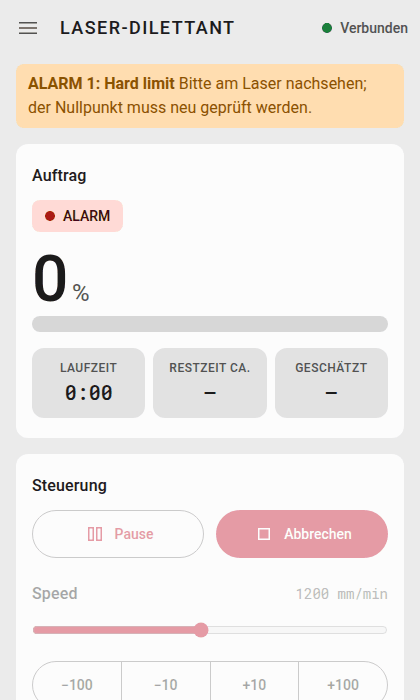

### Steuern (nur mit "Fernsteuerung erlauben")

- **Pause / Weiter:** Pause hält sofort an. **Weiter** fragt vorher nach, ob sich am Laser nichts verändert hat.
- **Abbrechen:** fragt nach, dann wie am PC (Reset und `M5`; danach die Position prüfen).
- **Speed und Leistung:** Die Regler zeigen **dieselben Werte und Bereiche wie die Regler im Programm**: Speed in mm/min (oder mm/s, wie dort eingestellt), Leistung in Prozent der Maschine. Mit den Knöpfen (−100, −10, +10, +100 beim Speed; −10, −1, +1, +10 bei der Leistung) oder dem Schieber. Am PC siehst du in der Statusleiste, was aus der Ferne getan wurde, und die Regler im Programm ziehen mit.

### Sicherheit der Fernansicht

- **Es ist kein HTTPS.** Das Passwort geht im WLAN **unverschlüsselt** über die Leitung. Nur in einem vertrauten Netz benutzen, nicht im Gast-WLAN und nicht über das Internet.
- Das Programm nimmt nur Verbindungen aus **privaten Netzen** an (10.x, 172.16–31.x, 192.168.x, 169.254.x und lokale Adressen). Alles andere wird sofort abgewiesen.
- Nach **fünf falschen Passwörtern** innerhalb von zehn Minuten ist die Adresse fünf Minuten lang gesperrt. Anmeldungen stehen im Systemprotokoll.
- Eine Sitzung dauert 12 Stunden oder bis zum Abmelden oder Ausschalten. **Änderst** du das Passwort, bleiben schon angemeldete Geräte bis dahin angemeldet; schalte die Fernansicht kurz aus und wieder ein, dann sind alle abgemeldet.
- Nicht im Router ins Internet weiterleiten (kein Port-Forwarding).

---

## 17. Firmware des Lasers

### Anzeigen

Menü Maschine → **Firmware …** (nur mit Verbindung) liest `$I`, `$$` und `$#` und zeigt Version, Optionen (die Buchstaben der Firmware im Klartext, zum Beispiel "V: variable Spindel"), alle Einstellungen mit Bedeutung und die Koordinatensysteme. Der Dialog schreibt nichts. **Kopieren** legt den Bericht in die Zwischenablage, **Neu lesen** holt ihn noch einmal.

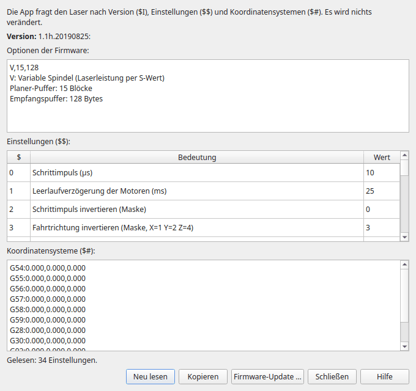

### Firmware-Update: Vorsicht

Der Knopf **"Firmware-Update …"** im Firmware-Dialog öffnet einen eigenen Dialog. **Ein Update kann den Laser unbenutzbar machen.**

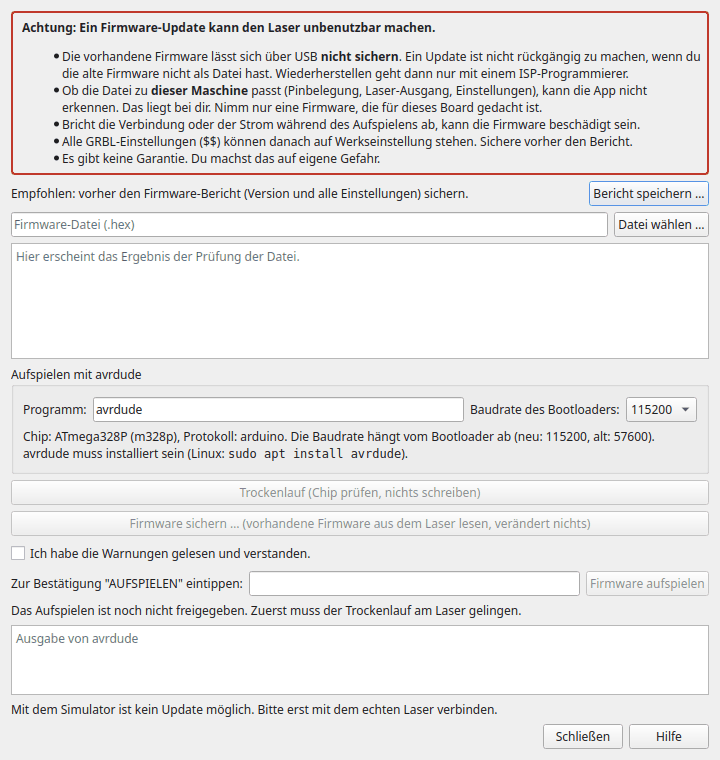

- Die vorhandene Firmware lässt sich über GRBL nicht auslesen. Ein Update ist nicht rückgängig zu machen, wenn du die alte Firmware nicht als Datei hast. Retten geht dann nur mit einem **ISP-Programmierer**.
- Ob eine Datei zu deiner Maschine passt (Pinbelegung, Laser-Ausgang), kann das Programm nicht prüfen. Das liegt bei dir.
- Bricht die Verbindung oder der Strom während des Aufspielens ab, kann die Firmware beschädigt sein. Alle GRBL-Einstellungen können danach auf Werkseinstellung stehen.

**Was das Programm macht:** Es ruft das externe Programm **avrdude** auf (Linux: `sudo apt install avrdude`). Chip: ATmega328P, Protokoll `arduino`. Die Baudrate des Bootloaders hängt vom Laser ab: der DIY8000 antwortet bei **57600**, andere Boards oft bei 115200.

1. **Bericht speichern:** sichert Version und alle Einstellungen als Text. Empfohlen vor jedem Update.
2. **Firmware sichern:** liest Flash (mit Bootloader) und EEPROM (dort liegen die `$`-Einstellungen) aus dem Chip und schreibt zwei Dateien (`<Name>.hex`, `<Name>-eeprom.hex`). Es wird **nichts geschrieben**. Das Programm prüft die Sicherung und zeigt die erkannte GRBL-Version und eine Prüfsumme. **Lege diese Dateien an einen sicheren Ort, am besten auf einen zweiten Datenträger.**
3. **Datei wählen:** eine `.hex`-Datei. Das Programm prüft sie als gültiges Intel-HEX, die Größe gegen den Flash und ob eine GRBL-Begrüßung im Programm steht.
4. **Trockenlauf:** verbindet über den Bootloader und liest nur die Chip-Signatur, schreibt nichts. Die Verbindung zum Laser wird dafür kurz getrennt, das Board startet neu. Meldet avrdude `not in sync`, die andere Baudrate probieren; antwortet auch dann nichts, hat dein Laser vermutlich keinen USB-Bootloader.

Das eigentliche **Aufspielen** ist in dieser Version **gesperrt**.

---

## 18. Tipps für gute Ergebnisse

Das sind allgemeine Erfahrungswerte für Diodenlaser, keine Zusagen für ein bestimmtes Material.

- **Immer erst testen.** Brenne einen **Materialtest** auf einem Rest des gleichen Materials, bevor du das Werkstück nimmst, und speichere die guten Werte als Material.
- **Fokus.** Ein sauberer Brennpunkt ist wichtiger als mehr Leistung. Mit dem **Schwachlicht** kannst du den Abstand einstellen.
- **Lieber schneller und öfter.** Statt einer hohen Leistung mit langsamer Fahrt oft **mehrere Durchgänge** mit mittlerer Leistung. Das gibt sauberere Kanten und weniger Verkohlung, besonders beim Schneiden.
- **Fotos** brauchen **Dithering** oder **Graustufen-Leistung**, **Schilder und Schrift** den **Schwellenwert**, **Umrisse zum Schneiden** den Modus **Cutting**.
- **Auflösung passend wählen.** Mehr Linien pro Millimeter als dein Laserpunkt breit ist, bringt nichts und macht den Auftrag nur länger. Bei einem Diodenlaser reichen oft 10 bis 15 Linien/mm (etwa 250 bis 400 dpi).
- **Holz und Maserung.** Bei Holz verläuft die Gravur oft besser quer zur Maserung (Richtung 90°).
- **Material fixieren.** Verrutscht das Material, wird das Bild unscharf oder verschoben. Gewichte oder Klebeband helfen.
- **Rahmen vor jedem Brand.** Er zeigt, ob das Bild an die richtige Stelle kommt.
- **Maß stimmt nicht?** Erst die Aufstellung im Maschinenprofil prüfen, dann **Kalibrieren** (Kapitel 11).
- **Gute Lüftung.** Gravieren erzeugt Rauch und Dämpfe. Lass die Abluft auch nach dem Brand noch kurz laufen.
- **Projekte speichern.** Mit dem Projekt hast du Bild, Einstellungen und Lage beisammen und kannst einen Auftrag später wiederholen.

---

## 19. Wenn etwas nicht klappt

**Der Port fehlt in der Liste.**
Linux: In der Gruppe `dialout`? (`groups`; sonst Kapitel 4.) Kabel und Stecker prüfen; `dmesg | tail` zeigt, ob der Chip erkannt wurde. Windows: Treiber für CH340/CH341 installieren.

**Verbinden klappt nicht oder GRBL antwortet nicht.**
Falsche Baudrate? **"Baudrate testen …"** nutzen. Ein anderes Programm (LaserGRBL, Engraver Master, Arduino-Monitor) hält den Port vielleicht noch offen.

**Der Selbsttest meldet eine Abweichung.**
`$30` weicht vom Profil ab: **"Profil auf $30 anpassen"** wählen. Laser-Modus fehlt (`$32=0` bei M4 im Profil): in den GRBL-Parametern `$32=1` setzen.

**Der Jog fährt nicht, obwohl die Konsole `ok` zeigt.**
Dein GRBL nimmt `$J=` an, fährt aber nicht (Firmware "1.1z" am DIY8000). Im Maschinenprofil, Reiter G-Code, den Haken "Jog mit dem GRBL-Befehl $J=" umstellen (Vorgabe: aus).

**Der Laser brennt nicht oder nur schwach.**
`$32=1` und der Laser-Befehl M4 im Profil müssen zusammenpassen. Maximale Leistung S im Profil gleich `$30` in GRBL? Leistung im Panel hoch genug? Beim Schwachlicht liegt die Obergrenze bei 5 %.

**Das Brennbild ist verschoben oder zu groß oder zu klein.**
Nullpunkt und Job-Ursprung prüfen (Kapitel 4 und 7). Maße zu groß oder zu klein: Kalibrierung (Kapitel 11). Gespiegelt oder gedreht: Aufstellung im Maschinenprofil.

**Alarm.**
Der Laser ist dabei aus. **Maschine → Alarm aufheben ($X)**, danach Nullpunkt prüfen und Material kontrollieren.

**Die Fernansicht ist nicht erreichbar.**
Läuft das Programm, und ist der Haken im Reiter Webzugriff gesetzt? Stimmt die Adresse (Handy im selben WLAN)? Ist der Port frei (die Statusleiste meldet, wenn er belegt ist), und blockiert eine Firewall? Meldet die Seite "Zu viele Versuche", ein paar Minuten warten.

**Die Fernansicht zeigt andere Werte als das Programm.**
Beide lesen dieselben Regler. Sieht es anders aus, die Seite neu laden und im Systemprotokoll nachsehen.

**Die Testnachricht von ntfy kommt nicht an.**
Dasselbe Thema in der ntfy-App abonniert? Internetverbindung des Rechners? Ist der Server richtig (`https://ntfy.sh`)? Der Dialog zeigt den Fehlertext.

**Ein Absturz mitten in der Arbeit.**
Das Programm sichert in einstellbaren Abständen automatisch und bietet beim nächsten Start die Wiederherstellung an. Auftrag und Fehler stehen im Protokoll (Kapitel 14).

---

## 20. Glossar

| Begriff | Bedeutung |
|---|---|
| **Aufstellung** | Drehung (0°, 90°, 180°, 270°) und Spiegelung des ganzen Lasers relativ zu dir. Steht im Maschinenprofil. |
| **Bootloader** | Kleines Programm im Chip des Lasers, das neue Firmware über USB annimmt. |
| **Cutting** | Gravurart: der Laser fährt Konturen nach (schneiden, umranden). |
| **Dithering** | Umwandlung von Grautönen in ein Punktmuster aus Schwarz und Weiß. |
| **Eilgang** | Schnelle Fahrt ohne Brennen (G0). |
| **Feed Hold** | Anhalten des Kopfes mitten im Lauf (die Pause). |
| **Full** | Gravurart: zusammenhängende Flächen werden im Zickzack gefüllt. |
| **G-Code** | Die Fahrbefehle, die an den Laser gehen (zum Beispiel `G1 X10 Y5 S500`). |
| **GRBL** | Die Steuerungs-Firmware des Lasers. Sie hat Einstellungen (`$0` bis `$132`) und Befehle. |
| **Graustufen-Leistung** | Die Leistung folgt dem Grauwert des Bildes (statt Punktmuster). |
| **Job-Ursprung** | Der Punkt des Auftrags (Ecke oder Mitte), der auf den Nullpunkt gelegt wird. |
| **Jog** | Den Kopf von Hand in Schritten fahren. |
| **Linie** | Gravurart: Rasterzeilen über das ganze Bild. |
| **Linien/mm, dpi, Pixelgröße** | Drei Arten, dieselbe Auflösung anzugeben. 15,7 Linien/mm = 400 dpi = 0,0635 mm. |
| **M3 / M4** | Befehle, die den Laser einschalten. M4 (Laser-Modus) passt die Leistung der Geschwindigkeit an; das braucht `$32=1`. |
| **Not-Aus** | Soft-Reset und `M5` (Laser aus). Kein Hardware-Not-Aus. |
| **Nullpunkt** | Die Stelle auf dem Material, die du mit "Hier ist Null" festlegst (X0 Y0). |
| **Operation** | Interne Bezeichnung für einen Arbeitsschritt (Art und Werte). |
| **Overrides** | GRBL-Funktion, mit der Speed und Leistung während des Laufs in Prozent verändert werden (die Live-Regler). |
| **Überscan** | Anlauf und Auslauf ohne Leistung an den Zeilenenden. |
| **Schwachlicht** | Dauerhaft eingeschalteter Laser mit sehr geringer Leistung zum Anpeilen und Fokussieren. |
| **Schwellenwert** | Helligkeitsgrenze: Dunkleres wird gebrannt, Helleres nicht. |
| **Soft-Reset** | Neustart von GRBL über die Leitung (Strg+X). Schaltet den Laser aus. |
| **ntfy** | Dienst für Nachrichten aufs Handy (siehe Kapitel 15). |

---

*Fehler im Programm oder in diesem Handbuch bitte auf <https://github.com/ohrenbeisser/Laser-Dilettant> melden.*
